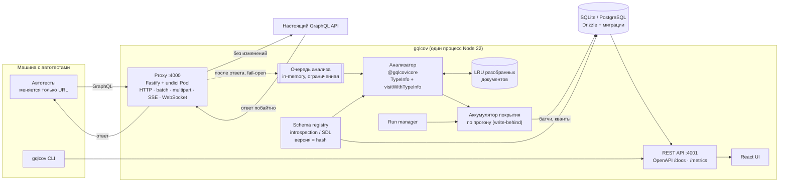

# Архитектура

## Путь запроса

1. **Proxy (горячий путь).** Тело читается сырым буфером, а multipart передаётся потоком: копия потока идёт в busboy только ради поля `operations`, файлы не буферизуются. Заголовки переписываются: убираются hop-by-hop и `X-Coverage-*`, подставляется `Host`, применяются правила `add` / `override` / `remove`. Запрос уходит через пул `undici`. Ответ транслируется клиенту потоком как есть (статус, заголовки, тело, SSE). Анализа на этом пути нет.
2. **После завершения ответа** в очередь кладётся задача: сырое тело, метаданные, HTTP-статус, копия JSON-ответа до 1 МБ для флага `has_errors`. Вся постановка в очереди обёрнута в `try/catch`, и ошибка только увеличивает `gqlcov_errors_total`. Если очередь переполнена, задача отбрасывается и это видно в `gqlcov_analysis_dropped_total`.
3. **Воркер** (тот же event loop, кванты около 2 мс) делает следующее:
   - разбирает тело (`POST` / `GET` / batch / `operations`);
   - разрешает APQ;
   - берёт `parse + validate` из LRU по ключу `hash(схема) : hash(query)`;
   - вызывает `analyzePrepared` с variables конкретного запроса;
   - определяет прогон;
   - добавляет результат в аккумулятор прогона и пишет журнал.
4. **Сброс** каждые `queue.flushIntervalMs`: журнал, документы и инкременты покрытия пишутся транзакциями по 100 строк с уступкой event loop между ними. Агрегаты хранятся по координате (`field_hit`, `field_test`, `arg_hit`, …), а не по строке на каждое поле каждого запроса.
5. **API** читает агрегаты, строит `CoverageReport` через `computeCoverage(модель схемы прогона, данные)` и кэширует его по версии данных прогона.

## Модули

| Модуль | Файл |
|---|---|
| Анализатор | `packages/core/src/analyze.ts` |
| Модель схемы, diff, federation | `packages/core/src/schema-model.ts` |
| Модель покрытия и определения | `packages/core/src/coverage.ts` |
| Разбор HTTP, APQ, редакция | `packages/core/src/http.ts`, `redact.ts` |
| Proxy HTTP и WebSocket | `apps/server/src/proxy.ts`, `ws-proxy.ts` |
| Очередь и анализ | `apps/server/src/pipeline.ts` |
| Схемы | `apps/server/src/schema-registry.ts` |
| Прогоны | `apps/server/src/runs.ts` |
| Хранилище | `apps/server/src/storage/{storage,sqlite,pg,schema.*}.ts` |
| REST API | `apps/server/src/api.ts` |

## Хранилище

| Таблица | Содержимое |
|---|---|
| `schema_snapshot` | `target`, `hash`, `sdl`, `source`, `created_at`. Версия = sha256 нормализованного SDL; для federation в хэш входит и карта владельцев |
| `run` | метаданные, статус, счётчики запросов |
| `operation_log` | журнал выполнения: запрос, редактированные variables, маскированные заголовки, тест, HTTP-статус, `has_errors`, `valid` / `invalid` / `unresolved`, задержка, покрытые поля |
| `query_document` | hash → текст (дедупликация, связка APQ) |
| `field_hit`, `field_test`, `arg_hit`, `enum_value_hit`, `input_field_hit`, `union_member_hit`, `run_test` | агрегаты покрытия |

Обе схемы (`schema.sqlite.ts` и `schema.pg.ts`) используют только переносимые типы. Время хранится в миллисекундах эпохи, JSON — текстом. Обе реализации проходят один контрактный тест.

## Multi-target

Каждая цель конфигурации — это маршрут (`/graphql` для первой, `/t/<name>/graphql`, необязательный `route`), свой пул соединений, своя версия схемы и свои прогоны. Это база для multi-service gateway: supergraph выставляется отдельной целью, а покрытие считается по сервисам-владельцам.
